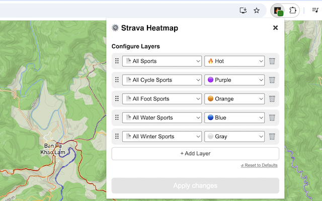

# Strava Heatmap extension

This browser extension seamlessly integrates the [Strava Global Heatmap](https://www.strava.com/maps/global-heatmap) into popular mapping editors, including the OpenStreetMap [iD editor](https://www.openstreetmap.org/edit?editor=id) and [GPX Studio](https://gpx.studio/app), enhancing your mapping and route analysis capabilities. In iD, [Strava Slide](#strava-slide-id) snaps a roughly drawn line onto the heatmap trail.

&nbsp;

## Pre-requisites

### Strava account

If you don’t already have a Strava account, you’ll need to create one (free) to use the Strava Heatmap.

1. Go to https://www.strava.com/register/free
2. Sign up using Google, Apple, Facebook, or your email

## Installation

### Chrome

Open the [Chrome extension page](https://chrome.google.com/webstore/detail/eglbcifjafncknmpmnelckombmgddlco) for the extension.

1. Click `Add to Chrome`.
2. Confirm permissions by selecting `Add extension`.
3. Chrome will briefly display a popup and show the new extension icon in the top-right toolbar.
4. Right-click the extension icon and choose `Pin` to keep it visible.
5. Alternatively, open the puzzle-piece Extensions menu and click the 📌 next to Strava Heatmap extension.

### Firefox

Open the [Firefox add-on](https://addons.mozilla.org/en-US/firefox/addon/strava-heatmap/) for the extension.

1. Click `Add to Firefox`.
2. Confirm permissions by selecting `Add`.
3. Firefox will briefly display a popup and show the new extension icon in the top-right toolbar.
4. Make sure `Pin extension to toolbar` is selected and click `OK`.
5. Alternatively, right-click the extension icon and choose `Pin` to keep it visible.

### Other browsers

The extension hasn't been tested or fully supported on other Chromium-based browsers like Brave and Opera.

### Versions

See the [Changelog](./CHANGELOG.md) for details.

### Instructions

## OpenStreetMap iD editor

To enable the Strava Heatmap in the iD editor:

1. Open the iD editor: https://www.openstreetmap.org/edit?editor=id
2. Press B or click Background settings, then scroll to Overlays.
3. Select a Strava Heatmap overlay from the list.
4. If you see the message "Click the Strava Heatmap extension icon to log into Strava…", click the red extension icon to authenticate.
5. After logging in, use the extension icon to configure heatmap layers: choose activity type and color, and manage layer order or deletion.
6. In the editor, press Shift + Q to toggle all overlays (including the heatmap), and Shift + W to toggle data visibility.

### Strava Slide (iD)

https://github.com/user-attachments/assets/0b53814f-94b8-4ed1-9380-0b048f3b9e37

With a Strava Heatmap overlay switched on and the extension signed in, an existing line can be snapped to the closest trace of that heatmap. Inspired by [Paul Mach's Slide](https://github.com/paulmach/slide/) and [Strava's iD integration](https://github.com/strava/iD).

1. Log into Strava with the extension and enable a Strava heatmap overlay.
2. Draw a rough line along the trail, or select an existing line. It can start and end on other roads or paths: those junctions stay in place, and the line is traced into them.
3. Press **Shift + S** (also right after drawing), or right-click the selected line and choose **Slide**.
   To slide only part of a way, select two or more of its points instead.
4. If several Strava overlays are enabled, choose the activity to follow.
5. Review the result before saving. Use iD's normal **Undo** to restore the original line.

What Slide changes:

- The line's first and last points, junctions with other ways, tagged nodes (fords, gates, crossings…) and relation members stay in place: to move one, disconnect it or move it by hand first.
- Where the line meets another road or path, it does not run along it. The heat of other mapped roads and paths is ignored, so a stronger parallel trail does not pull the line onto it.
- Sections with no usable heatmap trail are left as drawn, and the rest is slid. A message tells you how many.
- Near-duplicate points, tiny kinks and spikes are removed. Only untagged nodes not used by anything else are ever deleted.
- Bridges and tunnels themselves are not slid.

#### Known issues

Feedback and test cases are collected in [#43](https://github.com/julcnx/strava-heatmap-extension/issues/43). Always review the result before saving.

- **Parallel trails:** the heat within a few metres of other mapped roads and paths is ignored, and a section that would detour onto another heat trace is left as drawn. A point drawn closer to a stronger trail than to its own can still snap onto it. Workaround: Undo and slide only the sections around it (select two points: the selected end points stay in place), then fix that part by hand. Next step: snap to the closest trail rather than the strongest.
- **Tight switchbacks:** where the legs of a tight switchback merge into one band of heat, Slide cannot see the tip and cuts it short. Workaround: slide the line up to the switchback and from it (select two points), or move the tip by hand. Next step (v0.16.0): keep drawn tips where the heat cannot show them.
- **"Slide needs too many tiles":** the box around the line must fit in 16 heatmap tiles (about 4 × 4 km, less at high latitudes), so long or diagonal lines are refused. Workaround: select two points and slide the line in sections. Next step (v0.16.0): split long lines into sections automatically, with one Undo.

The extension's shortcuts are also listed in iD's keyboard shortcuts panel (**?**).

### GPX.studio editor

To enable the Strava Heatmap in GPX.studio:

1. Open GPX.studio: https://gpx.studio/app
2. Hover over the layers menu icon, then scroll to Overlays.
3. Choose a Strava Heatmap overlay from the list.
4. If you see the message "Click the Strava Heatmap extension icon to log into Strava…", click the red extension icon to authenticate.
5. Once logged in, use the green extension icon to configure, reorder, or delete heatmap layers by activity and color.

### Troubleshooting

**Q: “Click the Strava Heatmap extension icon to log into Strava and enable the heatmap.” — What does this mean?**  
**A:** This message appears if you're not logged in to Strava AND haven’t visited the [Strava Global Heatmap](https://www.strava.com/heatmap). Just click the extension icon to sign in and authorize access.

### Feature and Bug Requests

Submit issues and feature requests in the [Issues](https://github.com/julcnx/strava-heatmap-extension/issues) section above.

## Extension Background

Previously, accessing Strava heatmap in OpenStreetMap iD editor required a tedious process of extracting Strava website cookies and generating a temporary URL that would expire after a week.

The [JOSM Strava Heatmap Extension](https://github.com/zekefarwell/josm-strava-heatmap) simplified this process, but due to the lack of support for custom overlays in the iD editor, users could only add the URL as a custom background.

With this extension, you can now automatically access all Strava activities as Heatmap overlays, eliminating the need for manual URL management.

To learn more about using the Strava Heatmap in OpenStreetMap, visit the [Strava wiki](https://wiki.openstreetmap.org/wiki/Strava).

### Support for Other Sites

This extension currently supports the iD editor and [gpx.studio](https://gpx.studio). I'm not taking on additional sites at the moment. If you'd like to add support for another tool, feel free to fork the project.

- For JOSM, check out the [JOSM Strava Heatmap Extension](https://github.com/zekefarwell/josm-strava-heatmap).
- For RapidId, refer to the [RapId Power User Extension](https://github.com/emersonveenstra/rapid-power-user-extension/).
